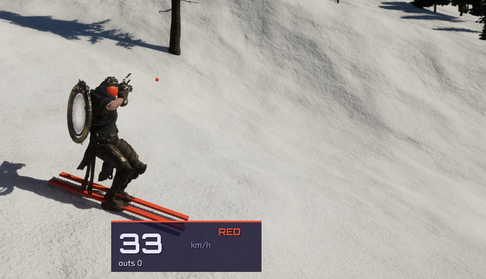
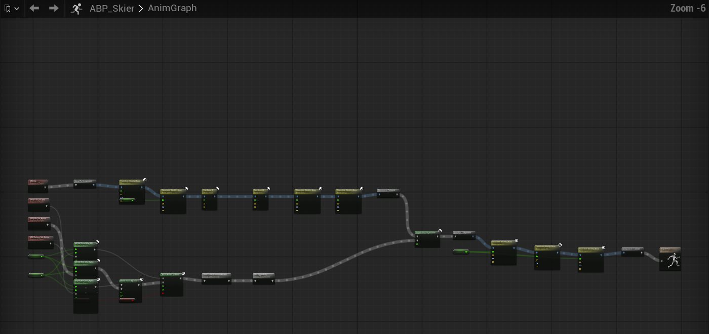

# Ski stance: legs on the skis, a crouch that grows with speed, aiming with the upper body

SKIvSKI's skiers stand on their skis with both feet pointing along them, crouch lower and lean forward the faster they
go, and still turn, aim, fire and reload with the upper body. This guide builds that **Animation Blueprint**
(`ABP_Skier`) by hand in the editor, step by step, so you can do the same for your own Creation: a skateboarder, a
snowboarder, someone on a sled or a horse, anything whose legs stay put while the arms keep fighting.



**You need:** the Other5 Creator project with the **Other5Characters** plugin (the mannequin and its poses) and
**Other5Combat** (the guns' fire and reload montages). Everything here is Blueprint: no C++.

**Learn more (Epic's docs):**
[Animation Blueprints](https://dev.epicgames.com/documentation/en-us/unreal-engine/animation-blueprints-in-unreal-engine),
[Layered Blend per Bone](https://dev.epicgames.com/documentation/en-us/unreal-engine/animation-blueprint-blend-nodes-in-unreal-engine),
[Two Bone IK](https://dev.epicgames.com/documentation/en-us/unreal-engine/animation-blueprint-two-bone-ik-in-unreal-engine),
[Transform (Modify) Bone](https://dev.epicgames.com/documentation/en-us/unreal-engine/animation-blueprint-transform-bone-in-unreal-engine),
[Aim Offsets](https://dev.epicgames.com/documentation/en-us/unreal-engine/aim-offset-in-unreal-engine),
[Animation Montages and Slots](https://dev.epicgames.com/documentation/en-us/unreal-engine/animation-montage-in-unreal-engine),
[IK Retargeter](https://dev.epicgames.com/documentation/en-us/unreal-engine/ik-rig-animation-retargeting-in-unreal-engine).

## How it fits together

```
LEGS (placed, not played)                                   UPPER BODY (played)
MM_Idle                                                     gun pose (pistol / rifle / shotgun)
 -> Local to Component                                       -> its Aim Offset (X = AimYaw, Y = AimPitch)
 -> Transform (Modify) Bone: pelvis down 5 cm                -> Blend Poses by Bool x2 (which kind of gun)
 -> Transform (Modify) Bone: pelvis down/back (Alpha = SkiCrouch)  -> Slot FullBodyAdditivePreAim (fire recoil)
 -> Two Bone IK: foot_l onto the left ski                    -> Slot UpperBody (reloads)
 -> Two Bone IK: foot_r onto the right ski                          |
 -> Transform (Modify) Bone: foot_l along the ski                   |
 -> Transform (Modify) Bone: foot_r along the ski                   |
 -> Component to Local ----- Base Pose ---> Layered Blend per Bone <- Blend Poses 0
                                             (spine_01 and up from the upper body)
                                              -> Local to Component
                                              -> Transform (Modify) Bone x3: spine_01..03 lean forward (Alpha = SkiCrouch)
                                              -> Component to Local -> Output Pose
```



Why the legs are *placed* rather than played: every mannequin pose, even plain `MM_Idle`, stands with the feet
staggered and turned out (the right foot 30 cm back and 47 degrees out). On skis that looks broken, so the legs take
the idle pose and IK moves each foot onto its ski.

## 1. Make the Animation Blueprint

1. In the Content Browser, in your plugin's folder: **Add > Animation > Animation Blueprint**. Skeleton:
   **SK_Mannequin** (Other5Characters' Manny/Quinn skeleton), parent class **AnimInstance**. Name it e.g.
   `ABP_Skier`.
2. **My Blueprint > Variables**, add (all in a category such as `Ski`):

   | Variable | Type | What it is |
   |---|---|---|
   | `SkiCrouch` | Float | 0 standing tall, 1 full crouch |
   | `AimYaw`, `AimPitch` | Float | where the player aims, relative to the skis |
   | `bArmsPistol`, `bArmsShotgun` | Boolean | which way to hold the gun in hand (both false: a rifle) |
   | `LeanDegrees` | Float, default **24** | how far the spine leans at full crouch (3 bones x 8) |

## 2. The Event Graph: work out the numbers every frame

On **Event Blueprint Update Animation**, with **Try Get Pawn Owner** (check it **Is Valid**):

- **Crouch:** `speed` = **Vector Length** of the pawn's **Get Velocity** (cm/s). Target = **Clamp**(0.3 + speed / 2800,
  0, 1): 30% standing still, full from about 70 km/h. **Set SkiCrouch** to **FInterp To**(SkiCrouch, target, Delta
  Time, 4) so it eases instead of snapping.
- **Aim:** **Delta (Rotator)** of the pawn's **Get Base Aim Rotation** and **Get Actor Rotation**. **Set AimYaw** to its
  Yaw clamped to -90..90. **Set AimPitch** to its Pitch **plus LeanDegrees x SkiCrouch x Cos (Degrees) of AimYaw**,
  clamped to -90..90. That extra pitch keeps the gun on target when the body leans forward (step 6). Base Aim Rotation
  replicates, so other players see you aim too.
- **Which gun:** **Cast** the pawn to your character, get the gun in hand, and set `bArmsPistol` / `bArmsShotgun` from
  it. (SKIvSKI keeps an `ArmsKind` number on each gun's data asset: 0 pistol, 1 rifle, 2 shotgun.)

## 3. The legs (Anim Graph)

Right-click in the **AnimGraph** and add these in a row, wiring each one's output pose into the next:

1. **Play MM_Idle** (Other5Characters `Template/Mannequins/Anims/Unarmed`).
2. **Local to Component**: skeletal controls work in component space.
3. **Transform (Modify) Bone**: Bone to Modify `pelvis`; Translation Mode **Add to Existing**, Translation Space
   **Component Space**, Translation **(0, 0, -5)**; Rotation and Scale Mode **Ignore**. The skier stands slightly lower.
4. **Transform (Modify) Bone**: the same settings with Translation **(0, -10, -34)**: hips down and back (on the
   mannequin, mesh +Y is forward). Wire **SkiCrouch** into its **Alpha**, so it only goes all the way at full crouch.
5. **Two Bone IK**: IK Bone `foot_l`; Effector Location Space **Component Space**, Effector Location **(13, 4, 8.5)**
   (13 cm to the side, on the ski); Joint Target Location Space **Component Space**, Joint Target **(15, 60, 50)** (in
   front of the knee, so it bends forward); **Allow Stretching** off.
6. **Two Bone IK** for `foot_r`: Effector **(-13, 4, 8.5)**, Joint Target **(-15, 60, 50)**.
7. **Transform (Modify) Bone**: `foot_l`, Rotation Mode **Replace Existing**, Rotation Space **Component Space**,
   Rotation **(85.6, 63.8, 66.8)** (pitch, yaw, roll); Translation and Scale **Ignore**. This points the toes along the
   ski.
8. The same for `foot_r` with Rotation **(-86.1, -109.2, -69.4)**.
9. **Component to Local**.

The two foot rotations are MM_Idle's own foot rotations turned about the vertical until the toes point straight ahead.
For another skeleton, open the idle animation, select the foot bone, read its rotation, and change the yaw until the
toes point forward.

As the hips drop with SkiCrouch, the IK keeps the feet on the skis, so the knees bend more the faster you go.

## 4. The upper body (Anim Graph)

1. For each kind of gun, a pose and its aim offset: **Play MM_Pistol_Idle_ADS** into **AO_MM_Pistol_Idle_ADS**;
   **MM_Rifle_Idle_Hipfire** into **AO_MM_Rifle_Idle_Hipfire**; **MM_Shotgun_Idle_Hipfire** into the rifle's aim offset.
   Wire `AimYaw` into each aim offset's **X** (Yaw) and `AimPitch` into **Y** (Pitch).
2. **Blend Poses by Bool** (`bArmsShotgun`): True = shotgun chain, False = rifle chain. A second one (`bArmsPistol`):
   True = pistol chain, False = the first blend.
3. **Slot**, slot name **FullBodyAdditivePreAim**: Other5Combat's fire montages (recoil) play here.
4. **Slot**, slot name **UpperBody**: its reload montages play here.

Montages only show if a Slot node with their slot's name is in the graph. If firing or reloading does nothing, open
the montage and check which slot it uses.

## 5. Join them: Layered Blend per Bone

1. Add **Layered Blend per Bone**. **Base Pose** = the legs (step 3's Component to Local), **Blend Poses 0** = the
   upper body (step 4's UpperBody slot).
2. Select it. In **Details > Config > Layer Setup > Index [0] > Branch Filters**, add one: Bone Name **spine_01**,
   Blend Depth **0**. Turn on **Mesh Space Rotation Blend**, so the chest faces where you aim even though the hips
   lean.

> **The one setting that breaks everything:** with no branch filter, Layered Blend per Bone adds nothing, and the whole
> body plays the legs' idle pose: the upper body stays rigid, facing forward, and never aims, fires or reloads (it
> happened to SKIvSKI 1.18-1.21). If your upper body is frozen, check this first.

## 6. Lean forward with speed, and keep the aim

1. After the Layered Blend per Bone: **Local to Component**, then three **Transform (Modify) Bone** nodes for
   `spine_01`, `spine_02` and `spine_03`. Each: Rotation Mode **Add to Existing**, Rotation Space **Component Space**,
   Rotation **Roll 8** (X 8, Y 0, Z 0), Translation and Scale **Ignore**, **Alpha** = SkiCrouch. Then **Component to
   Local** into the **Output Pose**.
2. Why Component Space and Roll: in component space X is the character's sideways axis, and a positive Roll tips the
   spine toward +Y, forward. Don't use Bone Space here: a spine bone's own axes are tilted (about 23 degrees on the
   mannequin), so a bone-space lean also tips the torso sideways, and the gun then aims low to one side and high to the
   other.
3. Leaning tips the arms and gun down by up to 24 degrees, but only when aiming ahead: aimed 90 degrees to the side, a
   forward lean just tilts the gun about its barrel. So step 2 adds `LeanDegrees x SkiCrouch x cos(AimYaw)` to the aim
   pitch, and the aim offset raises the arms by exactly what the lean took away, using the animators' own aim-up poses.
   The torso hunches forward like a real crouched shooter, and the gun still points where the player aims (SKIvSKI
   measured it within 1 degree of the uncrouched aim, from 80 degrees left to 80 degrees right).

**Compile**, **Save**, and in the preview (bottom right) try `SkiCrouch` at 0 and 1 by changing its default value.

## 7. Use it on your character

1. Open your character Blueprint, select **Mesh**, and set **Anim Class** to `ABP_Skier`.
2. Attach the gun to the mesh's **weapon_r** socket (Other5Combat's gun meshes point along +Y, so turn them -90 yaw).
3. Fire and reload with **Play Anim Montage** using Other5Combat's montages (e.g. `AM_MM_Pistol_Fire`,
   `AM_MM_Pistol_Reload`).

## 8. Guns in the hands of retargeted characters (Countess, Gideon ...)

A character from another skeleton (see the [Add a character](https://other5.xyz/Creators/AddingACharacter) guide) is
shown by **Other5 Character Skins** as its own mesh, attached to your character's mesh. The mannequin goes on animating
unseen, and the skin copies its pose through the IK Retargeter. Anything you attach to the mannequin's sockets follows
the *mannequin's* hand and head. The skin has its own arm lengths and head height, so the gun floats beside its hand
and the helmet beside its head.

The fix, in your character Blueprint, run every frame from **Event Tick** (a function `FitToSkin`):

1. Find the shown mesh: **Get Components by Class** (Skeletal Mesh Component), and for each one that **isn't** the
   character's Mesh, **Is Visible**, and whose **Get Attach Parent** is the Mesh, remember it as `ShownSkin`
   (otherwise `ShownSkin` = Mesh). A **Cast to Skeletal Mesh Component** is needed on the array items, and in a
   function a cast ends the flow, so do it in a tiny helper function that returns the cast result (or the Mesh).
2. `HandGap` = ShownSkin's **Get Socket Location** (`hand_r`) minus Mesh's **Get Socket Location** (`hand_r`).
   `HeadGap` the same with `head`.
3. Gun: **Set Relative Location** = your usual grip offset + **Unrotate Vector**(HandGap, Mesh's **Get Socket
   Rotation** (`weapon_r`)). Helmet: **Set Relative Location** = **Unrotate Vector**(HeadGap, Mesh's Get Socket Rotation
   (`head`)).

The gun stays attached to the mannequin (so it turns and aims with the arms), just moved by how far the visible hand is
from the hidden one. With a mannequin skin the gap is zero and nothing moves. Unrotating by the socket's rotation turns
the world-space gap into the socket's own space, which is the space a relative location is in.

## Tuning

| What | Where | SKIvSKI's value |
|---|---|---|
| How deep the crouch goes | pelvis node's Translation (step 3.4) | (0, -10, -34) |
| How fast it gets there | the crouch target in the Event Graph | 0.3 + speed / 2800 |
| Feet apart | the IK Effector X | 13 cm |
| How far the torso leans | spine nodes' Roll x 3, and `LeanDegrees` (keep them equal) | 8 each, 24 |

## Troubleshooting

- **Upper body frozen facing forward, no aiming, firing or reloading:** the Layered Blend per Bone has no branch filter
  (step 5).
- **Firing or reloading doesn't show:** the montage's slot name has no Slot node in the graph (step 4).
- **Gun aims too low when crouched:** `LeanDegrees` doesn't match the spine nodes' total, or isn't added to AimPitch.
- **Crouched, the gun aims low to one side and high to the other:** the spine lean is in Bone Space; use Component
  Space and Roll (step 6).
- **Legs stretch or knees bend backwards:** Allow Stretching is on, or the Joint Target is behind the knee (its Y must
  be forward, +Y on the mannequin).
- **Gun floats beside a hero's hand:** step 8.

## How SKIvSKI builds it

SKIvSKI's own copy is built from text by scripts over Unreal MCP (`Docs/Scripts/BuildAnimGraph.ps1`,
`SetupAnimation.py`, `Docs/Graphs/ABP_Skier.lisp`, `FitToSkin` in `Docs/Graphs/BP_SkiCharacter.Paint.lisp`). The
numbers above are the same; the scripts just save clicking.
